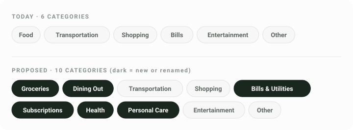
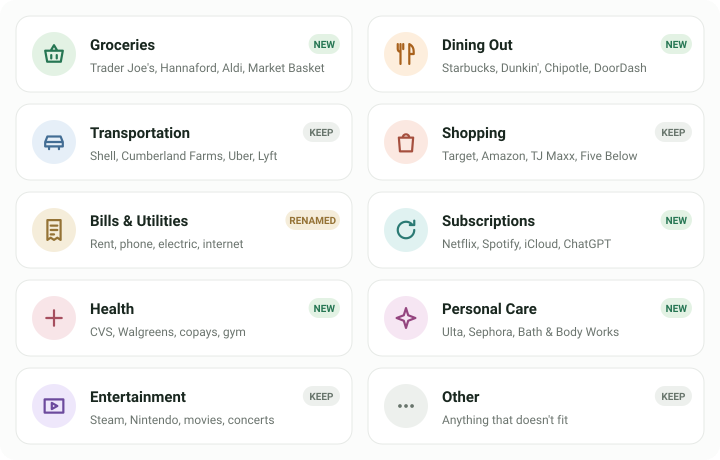
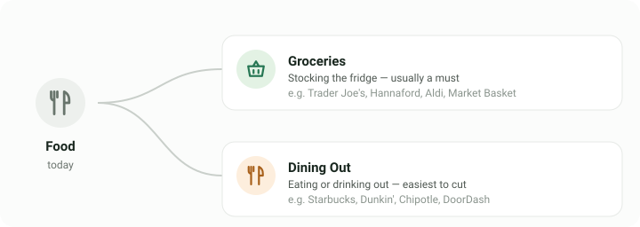

# Category proposal

Right now every transaction goes into one of **6 categories**: Food, Transportation, Shopping, Bills, Entertainment and Other. This proposal grows that to **10**, based on where your money actually goes (the ~140 brands the app already recognizes).

## The proposed set

| Category | Status | Why |
|---|---|---|
| Groceries | **New** (split from Food) | You shop at a lot of grocery stores, so this is one of your biggest buckets |
| Dining Out | **New** (split from Food) | Coffee, fast food and delivery. This is the spending that's easiest to cut |
| Transportation | Keep | Gas stations, Uber and Lyft already fit here |
| Shopping | Keep | Clothes, home goods and online orders |
| Bills & Utilities | **Renamed** from Bills | Makes it clear that rent, phone and power go here |
| Subscriptions | **New** | Netflix, Spotify, iCloud, ChatGPT and so on. Easy to forget, and they add up every month |
| Health | **New** | Pharmacy, copays and the gym. The app already has an icon and color for it, but it isn't in the list yet |
| Personal Care | **New** | Ulta, Sephora, Bath & Body Works. Right now these end up mixed into Shopping |
| Entertainment | Keep | Games, movies, concerts |
| Other | Keep | Catch-all |

## The biggest change: splitting Food

"Food" mixes two very different kinds of spending. Groceries are mostly a need. Eating out is a want, and it's usually the first place people look when trying to save. Splitting them makes the monthly breakdown much more useful.

## Ideas left out (add later if you need them)

- **Travel**: flights and hotels, if you take trips
- **Gifts**: birthdays and holidays
- **Education**: school fees, books, courses
- **Pets**
- **Home**: furniture and repairs (Home Depot, Lowe's, IKEA), if this gets big enough to track separately from Shopping

Ten chips already fill two rows on the add-expense screen. Every extra category makes picking one a little slower.

## What happens to old transactions

- Old **Food** entries still show up as Food, with the same icon and color. You can re-tag them by hand if you want, or leave them alone.
- **Bills** → **Bills & Utilities** keeps its icon and color automatically, because the app matches categories by the word "bill".
- Backups import fine. A category is just a text label, so nothing breaks.

## What it would take to build

1. Update the list in [src/utils/expenseHelpers.js](../../src/utils/expenseHelpers.js) (`EXPENSE_CATEGORIES`).
2. Add icons and colors for Groceries, Dining Out, Subscriptions and Personal Care in [src/pages/TransactionsPage.jsx](../../src/pages/TransactionsPage.jsx) and [src/App.css](../../src/App.css). Health already has both.
3. Optional: pick the category automatically from the brand (for example, Netflix → Subscriptions). The brand list already exists.
